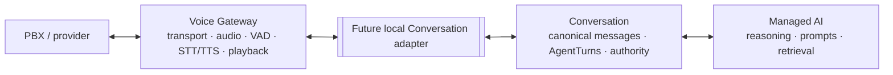

# Voice Gateway architecture

The adapter shown above is a future local seam only. This foundation does not
call Conversation, change its contracts, or send requests to Managed AI.

## Responsibilities and flow

1. A configured provider transport supplies bounded PCM16 little-endian,
   8 kHz, mono frames. This repository currently includes the AudioSocket TCP
   framing adapter. It validates the UUID handshake, frame size, sample rate,
   and PCM sample alignment.
2. `BatchSTT` keeps a bounded acoustic utterance in memory, applies energy VAD
   and end-of-speech, limits provider concurrency/backlog, and returns a final
   transcript through a callback.
3. `UtteranceCoordinator` can combine closely spaced acoustic finals. It is a
   media heuristic; it does not schedule or own a Main Chota `AgentTurn`.
4. `VoiceToConversationPort` is the typed future seam for call start/end, final
   utterance, authorized assistant speech, and playback facts. It is a Python
   protocol plus local dataclasses, not a wire protocol.
5. The host Conversation boundary may return `AuthorizedSpeech`. Voice can
   synthesize only that text, pace PCM playback, detect barge-in and report
   transport facts.

## Playback truth

`PlaybackFact` distinguishes not-started, started, partial, completed,
interrupted, failed and unknown. It carries both generated bytes and bytes
accepted by the transport. A completed fact means all generated frames were
handed to the transport. It does **not** prove the caller heard them. A partial
transport failure is `unknown`; barge-in is `interrupted`; neither is full
completion.

## State and failure handling

Call state exists only for the live process/session. It holds transport and
provider resources, transient VAD buffers and playback counters. On EOF, timeout,
cancellation or failure, the call closes output, stops utterance coordination,
closes the transport, drains/cancels STT work and closes TTS within configured
deadlines. A repeated close is safe. Provider shutdown errors are recorded by
type and do not skip later cleanup.

The service has no local spool by design. A process restart destroys the live
provider stream, so replaying raw audio cannot resume the call or restore
Conversation authority. There is no archive/recording requirement in this goal.
Frames, VAD utterances, STT backlog and active calls have explicit in-memory
bounds; writing audio to disk would add retention and cleanup risk without
recoverable call semantics.
Every inbound AudioSocket frame after the UUID handshake must arrive within the
configured idle timeout; otherwise the transient call ends with a timeout reason
and releases its admission slot. A transport EOF remains a disconnect.

## Ownership boundaries

- Voice: telephony/media transport, codecs, VAD, STT/TTS execution, acoustic
  utterances, playback, barge-in, transient call lifecycle and media observability.
- Conversation: canonical messages/history, AgentTurns, authority/control state,
  delivery evidence and linked Call metadata.
- Managed AI: reasoning, prompts, knowledge retrieval and AI orchestration.
- Business runtime: business capability semantics, confirmations, provider
  routing and BusinessOperation safety.

Voice never owns a second conversation history, decides assistant content,
executes Business tools, treats a customer confirmation as a booking, or stores
long-lived CRM state.
