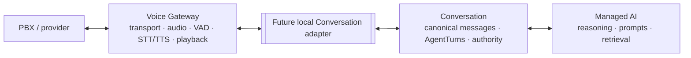

# Voice Gateway architecture

The default app keeps this boundary local and inert. An explicitly injected
candidate `ConversationHTTPPort` now implements the reviewable
[Conversation contract](conversation-contract.md); it is not enabled by default
and never calls Managed AI. Conversation owns the wire contract and canonical state.

## Responsibilities and flow

1. A configured provider transport supplies bounded PCM16 little-endian,
   8 kHz, mono frames. This repository currently includes the AudioSocket TCP
   framing adapter and an explicit native inbound SIP host adapter. AudioSocket
   validates the UUID handshake, frame size, sample rate and PCM sample alignment.
   SIP validates the configured PBX peer and called DID, then shares the same
   call owner and PCM pipeline. See [live runtime](live-runtime.md).
   Structured SIP diagnostics retain the inbound decision/status, registration
   state and disconnect phase flags, including whether Voice requested a local
   hangup. Native reason phrases, SIP messages, addresses and phone numbers are
   excluded. A local-request flag records an attempt, not delivery of a BYE;
   its absence does not identify which upstream party ended a call. Diagnostics
   are best-effort and cannot alter admission or cleanup.
2. `BatchSTT` keeps a bounded acoustic utterance in memory, applies energy VAD
   and end-of-speech, limits provider concurrency/backlog, and returns a final
   transcript through a callback. Optional SpeechKit v3 instead streams audio
   during speech over one bounded RPC per acoustic utterance. The same local
   VAD confirms the endpoint; only ordered final transcripts reach the callback.
   Provider partials and provider endpoint hints cannot grant a turn.
   A failed, still unadmitted utterance can make one additional recognition RPC
   after the local endpoint, using `FULL_DATA` on the same SpeechKit connection.
   This covers `UNAVAILABLE`, provider `DEADLINE_EXCEEDED`, `INTERNAL`, and an EOF
   before the local endpoint. Known credential, quota and invalid-request errors
   are not retried. The original final deadline bounds both attempts, including
   the small jittered backoff; callback failure cannot replay accepted text.
   Recovery PCM is memory-only, shares the acoustic byte limit, and is erased on
   recognition completion, failure or cancellation. No prior utterance is replayed.
3. `UtteranceCoordinator` can combine closely spaced acoustic finals. It is a
   media heuristic; it does not schedule or own a Main Chota `AgentTurn`.
   One explicit complete `+375` number, including bounded Russian spoken groups
   and a leading name/contact phrase, uses the existing 0.9-second continuation
   window. Pending finals are considered together without rewriting their text.
   A request of at most 512 characters can also use that window when it ends in
   exactly one complete phone number. Dates and times before that suffix do not
   extend the hold; whole-request ambiguity and correction checks still apply.
   Partial numbers, other countries, alternatives, extensions and corrections
   keep the 2.5-second numeric window, including long explicit phone fragments.
   Ongoing speech still postpones delivery; closure fences pending finals.
   Speech newer than the acoustic timestamp covered by a pending final restores
   the numeric wait while recognition catches up. This also keeps a request
   together with a subsequently dictated contact, including speech observed
   before the delayed request final. An ordinary final with an acoustic timestamp
   also waits up to 300 ms after arrival (capped by the configured silence window),
   allowing a quick final to meet a just-starting continuation. This is an explicit
   quiet-response latency cost; a missing continuation cannot extend it further.
   Adapters without acoustic-final timestamps retain the existing phone heuristic.
   Batch and SpeechKit speech timestamps never move backwards across packet
   bursts, so a final cannot appear older than speech it already covers.
   This fallback uses the existing bounded numeric window after the latest
   detected speech; the normal final-arrival hold still applies.
4. `VoiceToConversationPort` is the typed local seam for call start/end, final
   utterance, authorized assistant speech, and playback facts. It is a Python
   protocol plus local dataclasses, not a wire protocol.
   The optional `StreamingConversationPort` separates asynchronous authorized
   responses from final admission, so incoming speech can fence an in-flight AI
   answer. Boundary failure is supervised alongside the PBX read and stops playback.
5. The host Conversation boundary may return `AuthorizedSpeech`. Voice can
   synthesize only that text, pace PCM playback, detect barge-in and report
   transport facts.

## Playback truth

`PlaybackFact` distinguishes not-started, started, partial, completed,
interrupted, failed and unknown. It carries both generated bytes and bytes
accepted by the transport. A completed fact means all generated frames were
handed to the transport. It does **not** prove the caller heard them. A partial
transport failure is `unknown`; barge-in is `interrupted`; neither is full
completion.

For streamed speech, the HTTP adapter exposes the existing turn identifier as
an opaque local response group. If the caller interrupts one sentence, MediaCall
also fences late sentences from that group before synthesis, reporting
`not_started` with zero generated/accepted bytes. The serial response stream
retains only the last interrupted group per live call; it does not schedule or
cancel canonical turns. A fresh group's authorized speech can play normally.
Discarding a late suffix does not clear the wait for the caller's new answer.

After a terminal playback fact is attempted, cancellation/cleanup cannot emit a
different terminal fact for the same output: the original request may already
have committed even if its acknowledgement was lost. A playback POST already
in flight also finishes its acknowledgement and local sequence update before
propagating audio-producer cancellation. The existing HTTP request deadline
bounds that wait; a lost acknowledgement fails the boundary without retrying
with a conflicting fact. Audio remains revoked during this wait. Conversation boundary
diagnostics report only the operation, validation stage and HTTP status, never
payloads or exception details. A failed AI turn can receive a Conversation-owned
authorized failure response using the existing protocol, keeping media active;
Voice does not choose that text or retry the business action.

## State and failure handling

Call state exists only for the live process/session. It holds transport and
provider resources, transient VAD buffers and playback counters. On EOF, timeout,
cancellation or failure, the call closes output, stops utterance coordination,
closes the transport, drains/cancels STT work and closes TTS within configured
deadlines. A repeated close is safe. Provider shutdown errors are recorded by
type and do not skip later cleanup.

The service has no local spool by design. A process restart destroys the live
provider stream, so replaying raw audio cannot resume the call or restore
Conversation authority. There is no archive/recording requirement in this goal.
Frames, VAD utterances, STT backlog and active calls have explicit in-memory
bounds; writing audio to disk would add retention and cleanup risk without
recoverable call semantics.
The acoustic-final coordinator also has count/character bounds. A slow consumer
backpressures STT callbacks; exhausting the bounded STT backlog fails the call
explicitly. Shutdown clears pending acoustic data and fences late provider finals.
Connections and adapters created before `MediaCall.run` are owned by the runtime
and closed even when a later factory fails.
Every inbound AudioSocket frame after the UUID handshake must arrive within the
configured idle timeout; otherwise the transient call ends with a timeout reason
and releases its admission slot. A transport EOF remains a disconnect.

## Ownership boundaries

- Voice: telephony/media transport, codecs, VAD, STT/TTS execution, acoustic
  utterances, playback, barge-in, transient call lifecycle and media observability.
- Conversation: canonical messages/history, AgentTurns, authority/control state,
  delivery evidence and linked Call metadata.
- Managed AI: reasoning, prompts, knowledge retrieval and AI orchestration.
- Business runtime: business capability semantics, confirmations, provider
  routing and BusinessOperation safety.

Voice never owns a second conversation history, decides assistant content,
executes Business tools, treats a customer confirmation as a booking, or stores
long-lived CRM state.
